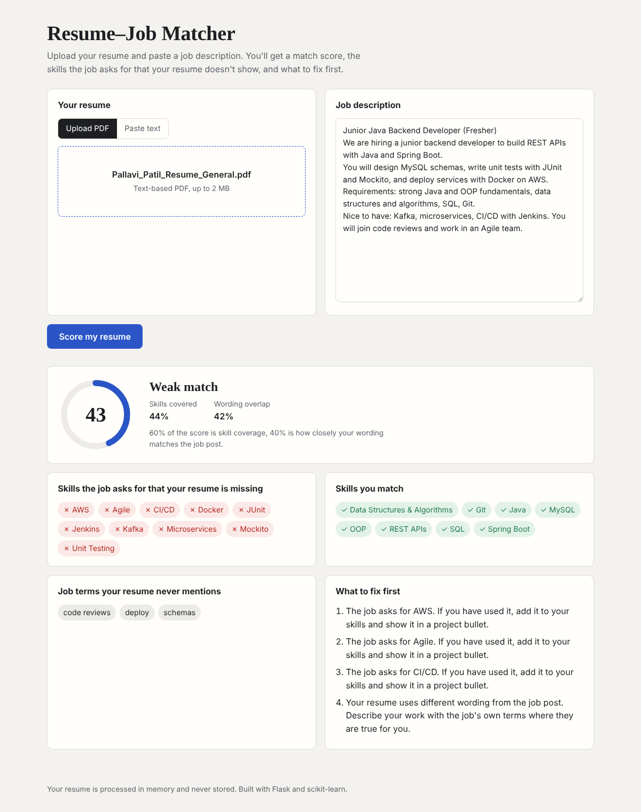

# Resume–Job Matcher

Upload a resume (PDF) and paste a job description. The app scores how well they match, lists the
skills the job asks for that the resume doesn't show, finds important job terms the resume never
mentions, and suggests what to fix first.

Built with **Python, Flask and scikit-learn**. PDF text is extracted with **pdfplumber**.



## How the score works

The score (0–100) is designed to be explainable, so every number on the page can be traced back:

| Part | Weight | How it's measured |
|---|---:|---|
| **Skill coverage** | 60% | The share of skills named in the job description that also appear in the resume. Skills are matched against a curated list of ~100 skills and their common spellings ([`app/data/skills.json`](app/data/skills.json)), e.g. *SpringBoot* = *Spring Boot*, *Postgres* = *PostgreSQL*. |
| **Wording overlap** | 40% | Cosine similarity of the two texts as term-frequency vectors of words and word pairs (scikit-learn `TfidfVectorizer` with IDF turned off: with only two documents, IDF would down-weight exactly the words they share). A similarity of 0.35 or more counts as full marks, since a resume and a job post never read alike. |

Verdicts: **75+** strong match · **50–74** good match with gaps · **below 50** weak match.

**Job terms your resume never mentions** are the job post's most frequent meaningful words and
word pairs (generic words like "team" or "experience" filtered out) that don't appear in the resume.

### Details that make the matching reliable

- Skill matching respects symbols and word boundaries: `C++`, `C#`, `.NET` and `node.js` are found
  correctly, and "git" inside "github" doesn't count as Git.
- Everyday words that are also tech names ("rest", "spring", "express") are not treated as skills
  unless written in a technical form (`REST API`, `Spring Boot`, `Express.js`).
- PDFs are checked before parsing: non-PDF files, scanned PDFs with no text, files over 2 MB and
  resumes over 5 pages get a clear error message.
- Resumes are processed in memory and never stored.

## API

`POST /api/score` (multipart form)

| Field | Required | Notes |
|---|---|---|
| `resume_file` | one of these two | PDF, up to 2 MB |
| `resume_text` | one of these two | plain text, at least 100 characters |
| `job_description` | yes | at least 80 characters |

Example response (shortened):

```json
{
  "score": 61,
  "verdict": "Good match with gaps",
  "similarity": 0.131,
  "skill_coverage": 0.75,
  "matched_skills": ["Git", "Java", "OOP", "Python", "REST APIs", "SQL"],
  "missing_skills": ["AWS", "Docker"],
  "extra_skills": ["Cypress", "Flask", "MySQL", "Playwright"],
  "missing_keywords": ["code reviews", "cloud infrastructure"],
  "suggestions": ["The job asks for AWS. If you have used it, add it to your skills and show it in a project bullet."]
}
```

Errors return `400` (or `413` for large files) with `{"error": "...", "field": "..."}`.

`GET /health` returns `{"status": "ok"}`.

## Tests

| Suite | What it covers |
|---|---|
| [`tests/test_matcher.py`](tests/test_matcher.py) | Skill aliases, symbols and word boundaries, ambiguous words, similarity behaviour, keyword filtering, score bounds and ordering (13 tests) |
| [`tests/test_api.py`](tests/test_api.py) | Home page, health check, PDF upload, pasted text, non-PDF rejection, missing fields, 2 MB limit (8 tests) |
| [`tests/e2e/score.spec.ts`](tests/e2e/score.spec.ts) | Playwright (TypeScript) end-to-end tests on desktop and mobile: upload and score, paste and score, form errors, server error messages (4 tests × 2 viewports) |

```bash
# unit and API tests
pip install -r requirements.txt
pytest -v                 # or: python -m unittest discover -s tests -t .

# end-to-end tests (starts the app automatically)
npm install
npx playwright install chromium
npx playwright test
```

GitHub Actions runs all three suites and a Docker build on every push.

## Run it

```bash
pip install -r requirements.txt
flask --app app run          # http://127.0.0.1:5000
```

With Docker:

```bash
docker build -t resume-job-matcher .
docker run -p 8000:8000 resume-job-matcher   # http://localhost:8000
```

### Deploy to Render

The repo includes [`render.yaml`](render.yaml). On [Render](https://render.com), choose
**New → Blueprint**, pick this repository, and it builds the Docker image and deploys it.

## Project structure

```
├── app/
│   ├── __init__.py        # Flask app: page, /api/score, /health, error handling
│   ├── matcher.py         # skill extraction, similarity, keyword gaps, score and suggestions
│   ├── pdf_utils.py       # safe PDF text extraction
│   ├── data/skills.json   # skills, categories and their common spellings
│   ├── templates/index.html
│   └── static/            # style.css, app.js
├── tests/                 # unittest/pytest + Playwright tests and fixtures
├── Dockerfile
├── render.yaml
└── .github/workflows/ci.yml
```

## Ideas for next steps

- Optional LLM-written rewrite suggestions, with the API key read from an environment variable
- Weight required skills above "nice to have" skills by detecting those sections of the job post
- Let users save and compare several job descriptions

---
Built by **Pallavi Patil** · [LinkedIn](https://www.linkedin.com/in/pallavi-patil-6baa13253) · [GitHub](https://github.com/pallavipatil1111)
